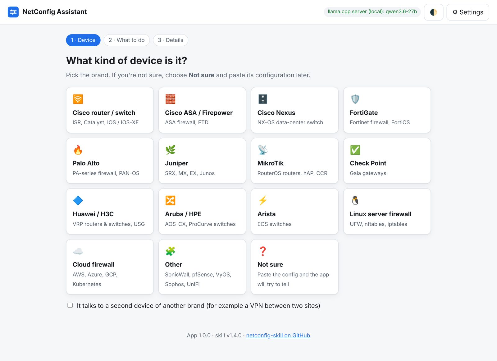
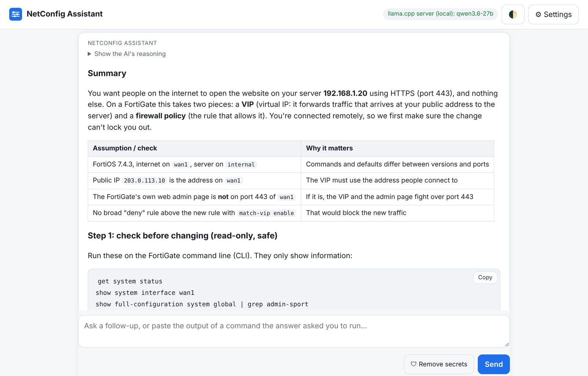

# netconfig-skill

[](https://github.com/Lumax-Solutions/netconfig-skill/releases/latest)
[](https://github.com/Lumax-Solutions/netconfig-skill/actions/workflows/validate.yml)
[](LICENSE)
[](https://agentskills.io/)

An **Agent Skill** that turns an AI coding/chat agent into a careful senior network engineer for
routers, switches and firewalls. It writes paste-ready configs, **safely changes devices that are
already running**, reviews and audits configs, reads `show`/`debug` output, and converts configs
between vendors — with state checks, a minimal diff, an armed rollback and allow/deny tests built
in, so you don't break production or lock yourself out of a remote box.

> **Not a developer?** Use the **[NetConfig Assistant desktop app](#desktop-app-for-non-experts)**:
> pick your device, say what you want, and get step-by-step commands with Copy buttons.

## See it work: tighten SSH without locking yourself out

> *"I'm connected over SSH from the admin host 198.51.100.10 (IPv6 2001:db8:100::10). Restrict NEW SSH
> connections to that admin host only, and keep the public website (TCP 80/443) reachable over IPv4
> and IPv6 from anywhere. I don't want to lock myself out."* — [full prompt](tests/lab/ssh-lockdown/scenario.md)

The skill's answer ([full text](tests/lab/ssh-lockdown/skill-answer.md)) checks the live state first,
backs up the running ruleset, arms a rollback timer that reloads the backup in 10 minutes, then
swaps only the input chain:

```text
ip saddr 198.51.100.10 tcp dport 22 accept
ip6 saddr 2001:db8:100::10 tcp dport 22 accept
tcp dport 22 counter drop
tcp dport { 80, 443 } accept
```

Its commands, copied verbatim, are run in a [disposable Linux firewall lab](tests/lab/README.md)
on every push, from separate client hosts:

| Check (IPv4 and IPv6) | Result |
|---|---|
| Existing SSH session survives the change | ✅ |
| New SSH from the admin host works | ✅ |
| New SSH from any other host is blocked | ✅ |
| Website (80/443) still reachable from anywhere | ✅ |
| Not confirmed → the timer restores the original access | ✅ |
| Confirmed → the restriction stays, also after reloading the saved config | ✅ |

**And it knows when to stop.** Asked to publish a FortiGate server on a public IP and port that an
existing VIP already uses, it doesn't overwrite it: it flags the conflict, preserves the existing
service and the existing `WEB-02` object, checks `match-vip` on the deny rule above, and asks for a
decision before changing anything ([sample answer](tests/codex/sample-outputs/v1.2.1/with-skill.md)).

> **New in v1.3.0:** the lab above, [`SOURCES.md`](SOURCES.md) (53 version-sensitive claims with
> vendor links and check dates), Claude Code plugin install, and corrections from re-checking every
> source. **v1.2:** the change workflow for live devices.

**Install in one line** (into every agent on your computer — details in [INSTALL.md](INSTALL.md)):

```powershell
irm https://raw.githubusercontent.com/Lumax-Solutions/netconfig-skill/main/install.ps1 | iex   # Windows
```
```bash
curl -fsSL https://raw.githubusercontent.com/Lumax-Solutions/netconfig-skill/main/install.sh | bash   # macOS / Linux
```

Works with Claude Code, Claude apps, Codex, Antigravity, Gemini CLI, Cursor, GitHub Copilot,
Windsurf, Cline, Roo, Kiro, OpenCode, Hermes, Goose, Amp and other agents that support
[Agent Skills](https://agentskills.io/) — or any LLM via [`dist/AGENTS.md`](dist/AGENTS.md).

| Area | Platforms |
|---|---|
| Cisco | IOS / IOS-XE (ISR, ASR, Catalyst, C8000v), NX-OS (Nexus), ASA, Firepower FTD |
| Firewalls | Fortinet FortiGate (FortiOS 6.4–7.6), Palo Alto PAN-OS, Check Point Gaia, Huawei USG, SonicWall, Sophos, pfSense/OPNsense |
| Routing / switching | Juniper Junos (SRX, MX, EX/QFX), MikroTik RouterOS v7, Huawei VRP, Aruba/HPE AOS-CX, Arista EOS, VyOS/EdgeOS |
| Host & cloud | UFW, nftables, iptables, Windows Defender Firewall, AWS SG/NACL, Azure NSG, GCP firewall rules, Kubernetes NetworkPolicy |

Topics: changes to existing devices, interfaces, VLANs/trunks/LACP, static/OSPF/BGP, ACLs and
firewall policies, NAT/PAT/VIPs, site-to-site IPsec (IKEv2, route-based), SD-WAN, HA, IPv6 /
dual-stack, hardening, audits, cross-vendor migration, troubleshooting.

> **Disclaimer.** This skill produces suggestions, not guarantees. Always review generated
> configuration, test in a lab or maintenance window, keep out-of-band access, and verify
> version-specific syntax on your device (`?` / tab completion). You are responsible for changes
> made to your equipment. Vendor and product names are trademarks of their respective owners;
> this project is not affiliated with or endorsed by any vendor. This is a free, community project
> provided as is (see [LICENSE](LICENSE)); issues are handled on a best-effort basis, with no
> support or response time promised.

---

## Desktop app for non-experts

**NetConfig Assistant** puts the skill behind a simple, guided app that runs on your own computer.
No agent or coding tool needed.



1. **Choose the device** (or *Not sure*), **choose the task** (set up, change a live device, fix,
   review, migrate, ask), and **describe it** in your own words, in any language.
2. Get a plain-language answer: what will change, the checks it made, numbered steps with a
   **Copy** button on each command, tests (what should work *and* stay blocked), and how to undo it.
3. Ask follow-ups or paste command output; save the conversation as a file.



- **Your AI, your choice:** a model on your computer (llama.cpp, Ollama, LM Studio: private and
  free) or Claude, OpenAI and other services.
- **Secrets stay home:** passwords and keys in pasted configs are removed on your computer before
  sending, and the app shows what it removed.
- **Advice only:** it never connects to your devices.

**Get it:** download `NetConfig-Assistant.zip` from the
[latest release](https://github.com/Lumax-Solutions/netconfig-skill/releases/latest), unzip it, and
double-click **Start NetConfig Assistant**. Needs Python 3.9+.
Full guide with screenshots: **[app/README.md](app/README.md)**.

## What makes it different from asking an LLM directly

- **Built for changing live networks.** For an existing device it follows a change workflow:
  collect the current state with read-only commands → propose a minimal Add/Modify/Remove diff and
  flag conflicts (name clashes, shadowing rules, overlapping VIPs/NAT) → arm the platform's
  automatic rollback (`configure revert timer`, `commit confirmed`, Safe Mode, `checkpoint auto` …)
  → apply in phases → test what must work **and** what must stay blocked → save only after it passes.
  It knows what each rollback restores (running vs saved config) on 11 platforms.
- **Proportional.** Quick questions get quick answers; greenfield builds skip the state collection.
- **Version-aware.** Known syntax changes are spelled out (e.g. FortiOS IKE debug filter changed in
  7.4.1, SSL-VPN tunnel mode removed in 7.6.3, RouterOS 7.20 BGP instances, PAN-OS advanced
  routing engine, VyOS 1.4 firewall syntax).
- **Encodes the gotchas that break production:** Cisco VTI "any/any" selectors vs FortiGate phase 2,
  FortiGate VIP-as-dstaddr and post-DNAT service ports, PAN-OS pre-NAT IP / post-NAT zone and U-turn
  NAT, ASA security-level implicit permits during migrations, stateless WAN ACLs that break PAT
  return traffic, Junos BGP not being RFC 8212-safe by default, `no-readvertise` killing exports,
  MikroTik bridge VLAN filtering lockouts, Docker bypassing UFW …
- **IPv6 and dual-stack aware**, with a checklist for the classic gap: IPv4 locked down, IPv6 wide open.
- **Small context footprint.** A ~220-line core plus one reference file per platform, loaded only
  when needed.

## Test results

Answers were generated with and without the skill on the same prompts, then graded against
objective checks and reviewed by a separate model acting as a senior network engineer
(November 2026). Cases live in [`skills/network-config/evals/`](skills/network-config/evals).

| Case | Without skill | With skill | Notable difference found in review |
|---|---|---|---|
| FortiGate ↔ Cisco ISR IPsec (remote change) | 7/7 | 7/7 | Skill: correct 7.4 debug syntax, Null0 anti-leak route on Cisco |
| ASA → FortiGate migration | 7/8 | 8/8 | Baseline: wrong hairpin advice, no backup/rollback |
| Cisco router security audit | 9/9 | 9/9 | Baseline: proposed WAN ACL breaks PAT return UDP, no auto-rollback |
| MikroTik VLANs + guest isolation | 7/7 | 7/7 | Early skill version missed NAT and had a rule-order slip (fixed) |
| Palo Alto DNAT + U-turn | 6/7 | 7/7 | Baseline: no validate/backup/rollback, no default-vwire warning |
| FortiGate debug-flow diagnosis | 6/6 | 6/6 | Both correct |
| Juniper SRX BGP (prompt in Arabic) | 7/8 | 8/8 | Baseline: `no-readvertise` blocks the advertisement, possible SSH lockout, wrong rollback number |

**v1.2 vs v1.1** (existing-device changes, November 2026):

| Case | v1.1 | v1.2 | Difference |
|---|---|---|---|
| Change a live FortiGate with planted conflicts (busy VIP port, name clash, deny rule above) | 4/8 | 10/10 | v1.1: no diff, single paste, no blocked-traffic test |
| FortiGate ↔ Cisco IPsec, remote | 7/8 | 10/10 | v1.1 edited the Cisco WAN ACL before arming the rollback timer |

The checklists alone don't separate the two well; the real gap is in **errors that would break
traffic or lock you out**, which the skill avoided and the baseline didn't. Treat these as a small
sample, not a guarantee.

### Independent tests (OpenAI Codex CLI, November 2026)

Run by a separate agent with its own harness and checklist, written before generating answers.

| Test | Result |
|---|---|
| Answer quality, v1.2.0 (3 cases, skill content supplied vs plain model) | 20/20 vs 19/20 — and it **found a factual error** in the skill (FortiGate `match-vip` default) |
| Retest after the fix, v1.2.1 | 20/20 vs 18/20; the `match-vip` regression check passes |
| Release check, v1.3.0 | 20/20 vs 19/20; activation again 8/8 and 0/4; the VPN troubleshooting request now reads the FortiGate and Cisco references (fix confirmed in two runs); 3 `SOURCES.md` rows spot-checked, no contradictions |
| Automatic activation, v1.2.1 (installed skill, ordinary requests, 12 fresh sessions) | Loaded for **8/8** networking requests (5 vendors, Arabic, review, migration, Linux) and **0/4** unrelated ones (general concepts, Python networking code) |

Limits: one run per case, graded by the same agent that ran the test (not blind), model version not
pinned. They're smoke tests, not statistical proof or tests on real hardware. The test kit is in
[`tests/codex/`](tests/codex/README.md), so anyone can repeat these runs on a new release. The value shown is
consistency (backup, conflict checks, blocked-traffic tests in every answer) more than large score gaps.

## Platform coverage

| Depth | Platforms |
|---|---|
| **Detailed** (full syntax, version notes, tested scenarios) | Cisco IOS/IOS-XE, Cisco ASA, FortiGate, Palo Alto PAN-OS, Juniper Junos, MikroTik RouterOS |
| **Standard** (core syntax and troubleshooting) | Cisco NX-OS, Check Point, Huawei VRP/USG, Aruba AOS-CX, Linux / Windows / cloud firewalls |
| **Brief** (pointers; verify on the device) | Cisco FTD, Arista EOS, SonicWall, VyOS/EdgeOS, pfSense/OPNsense, Sophos, UniFi |

## Install

**Quickest** — installs into every agent on your computer (Claude Code, Codex, Cursor, Copilot,
Antigravity, Gemini CLI, Windsurf, Cline, Roo, Kiro, OpenCode, Hermes and more):

```powershell
# Windows (PowerShell)
irm https://raw.githubusercontent.com/Lumax-Solutions/netconfig-skill/main/install.ps1 | iex
```
```bash
# macOS / Linux / WSL
curl -fsSL https://raw.githubusercontent.com/Lumax-Solutions/netconfig-skill/main/install.sh | bash
# or, with Node.js, pick agents interactively:
npx skills add https://github.com/Lumax-Solutions/netconfig-skill/tree/main/skills/network-config -g
```

**From inside your agent** — paste the install prompt from [INSTALL.md](INSTALL.md#2-paste-a-prompt-into-your-agent)
and the agent installs the skill itself.

**Claude apps (claude.ai / Desktop)** — zip `skills/network-config` and upload it under
*Customize → Skills*.

**Claude Code (plugin)** — in a session:
```
/plugin marketplace add Lumax-Solutions/netconfig-skill
/plugin install netconfig@netconfig-skill
```

**Hermes Agent** — Windows, macOS, Linux or WSL (the install scripts above also detect Hermes):
```bash
hermes skills install Lumax-Solutions/netconfig-skill/skills/network-config --category networking --force
```
`--force` is needed because Hermes' scanner flags the `sudo` examples in the Linux reference;
details, profiles and updates in [INSTALL.md](INSTALL.md#hermes-agent).

**No agent? Use the desktop app** — [NetConfig Assistant](app/README.md): a guided app on your own
computer for people new to networking, with local or cloud AI.

**Any other tool or local model** — use the single-file build [`dist/AGENTS.md`](dist/AGENTS.md)
as a rules file or system prompt.

Per-agent paths, native install commands, verification and troubleshooting:
**[INSTALL.md](INSTALL.md)**.

## Example prompts

- "Site-to-site IPsec between our FortiGate 100F (7.4) and a Cisco ISR 4331 (IOS-XE 17.9). I'm doing the Cisco side remotely."
- "Convert this ASA config to FortiGate 7.2" *(paste config)*
- "Audit this router config for security issues" *(paste config)*
- "Port forward isn't working, here's `diagnose debug flow`" *(paste output)*
- "MikroTik hAP ax3: staff and guest VLANs, guest isolated, I'm connected on ether5."
- "عايز أعمل BGP مع مزود الخدمة على Juniper SRX300" — works in any language.

## Repository layout

```
skills/network-config/        ← the skill (copy this folder)
├── SKILL.md                  core workflow, safety rules, vendor detection, concept map
├── references/               one file per platform + change workflow, IPv6, sanitizing, audit, migration
└── evals/                    test cases (prompt.md, case.yaml, graders/)
INSTALL.md                    installation guide for every agent
SOURCES.md                    vendor source, versions and last-checked date for each sensitive claim
.claude-plugin/               Claude Code plugin + marketplace manifests
tests/lab/                    disposable Linux firewall labs (run in CI)
tests/codex/                  independent Codex test kit
app/                          NetConfig Assistant: guided desktop app (local web UI, any AI backend)
install.ps1 / install.sh      one-line installers
dist/AGENTS.md                single-file build for non-skill tools (generated)
scripts/validate.py           structure / link / paste-safety checks (run in CI)
scripts/build_agents_md.py    builds dist/AGENTS.md
scripts/build_app_zip.py      builds the NetConfig-Assistant.zip release download
```

## Running the evaluations

Each case under `skills/network-config/evals/` contains the user prompt and one grader file per
check. With Claude Code ≥ 2.1.269 you can run them with and without the skill:

```bash
cd skills/network-config
claude plugin eval . --allow-tools Write,Edit,Bash
```

These are real, billed model runs. Without Claude Code, run the prompts in any agent with and
without the skill and grade answers against the `graders/` files by hand.

## Roadmap

- **More labs:** FRR (BGP/OSPF) and VyOS scenarios in the same CI lab; MikroTik CHR if feasible.
- **Commercial-vendor lab results** (Cisco, FortiGate, Palo Alto, Juniper) from people with labs —
  use `tests/lab/ssh-lockdown/lab.py`'s pattern or the [test-case template](https://github.com/Lumax-Solutions/netconfig-skill/issues/new/choose).
- Re-confirm the 7 `UNVERIFIED` claims in [SOURCES.md](SOURCES.md) (mostly Juniper pages that
  block automated checks).
- More IPv6 depth for the Standard platforms.

See [CHANGELOG.md](CHANGELOG.md) and [Releases](https://github.com/Lumax-Solutions/netconfig-skill/releases).

## Contributing

Corrections from people running this gear are very welcome — please include the OS version and a
vendor doc link. See [CONTRIBUTING.md](CONTRIBUTING.md). Report wrong commands with the
"Wrong or outdated command" issue template.

**Try it on a real task and share it:** the "Share a test case" issue template asks for the
platform/version, a sanitized starting config, the change you asked for, and one thing that must
keep working. Confirmed failures become regression tests.

## License

[MIT](LICENSE)
