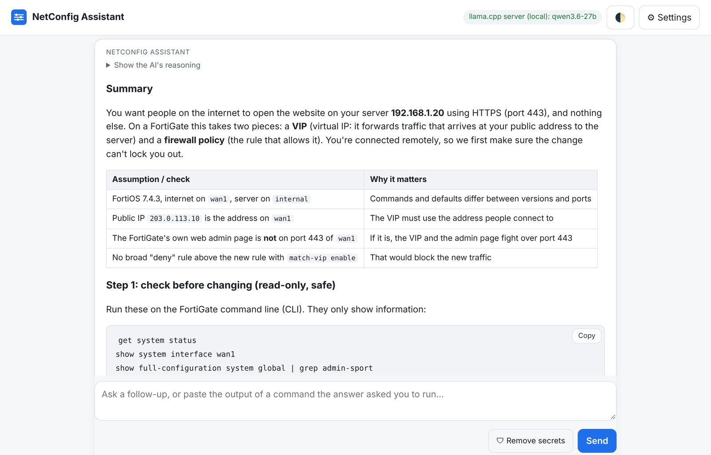
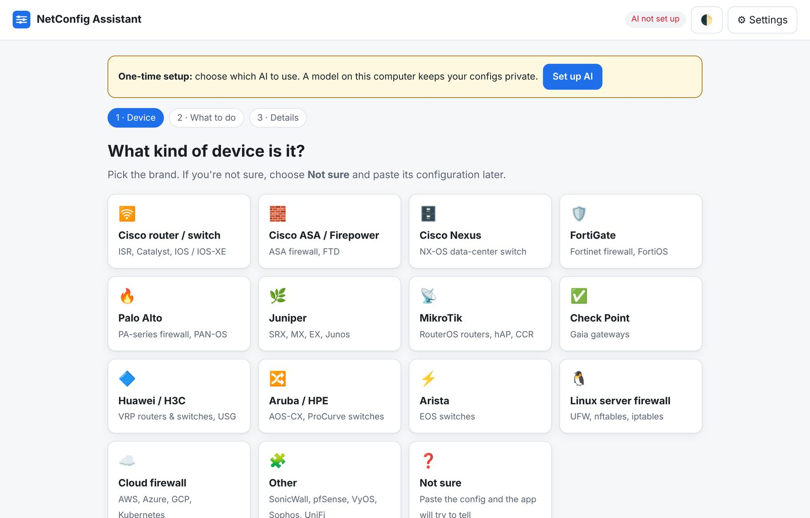
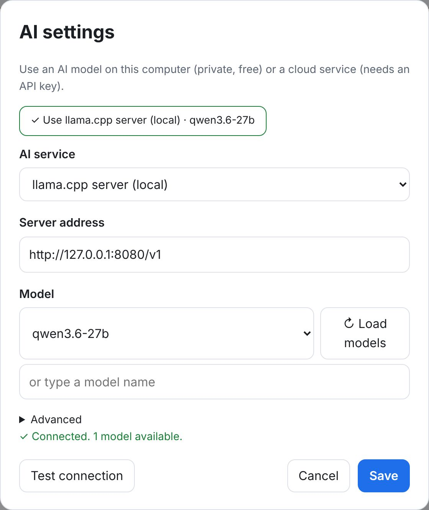
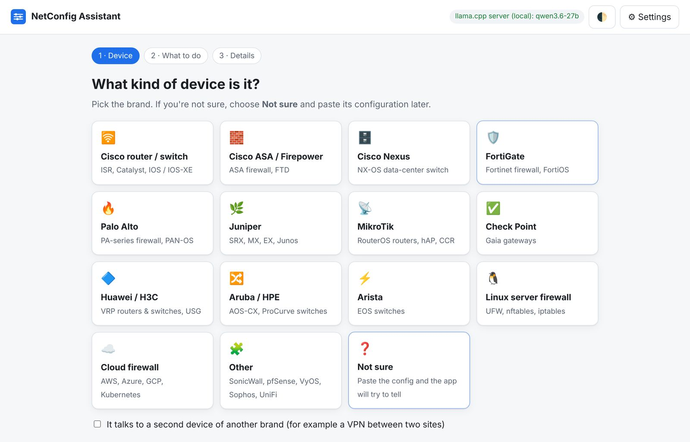
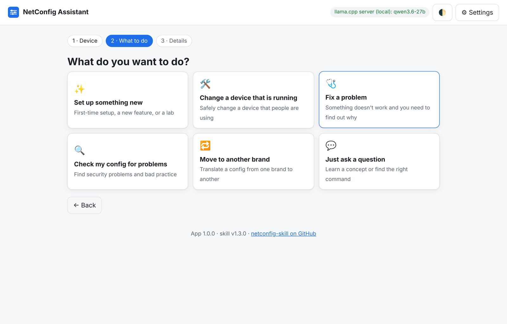
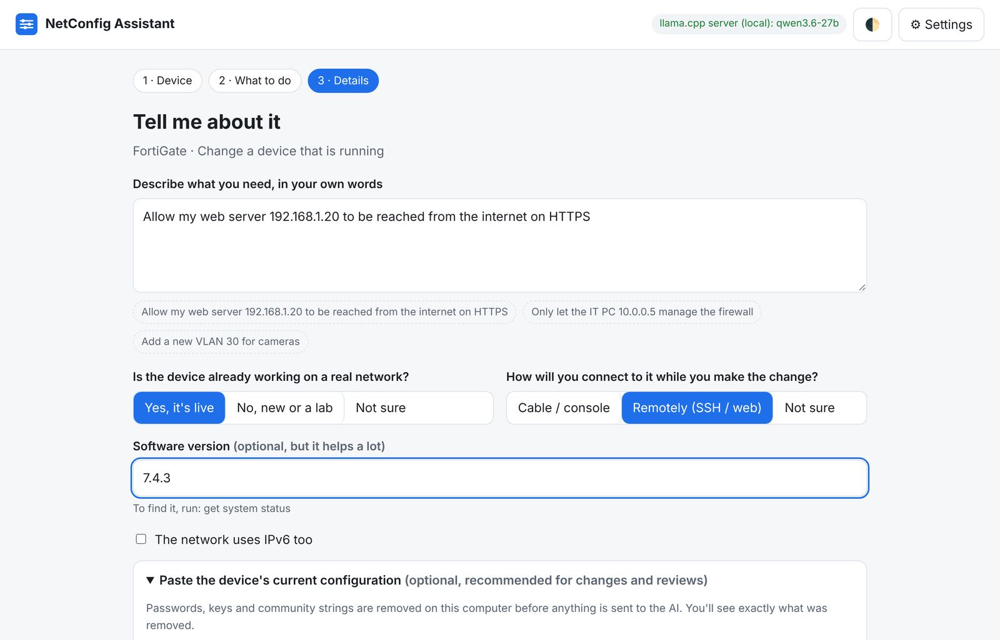
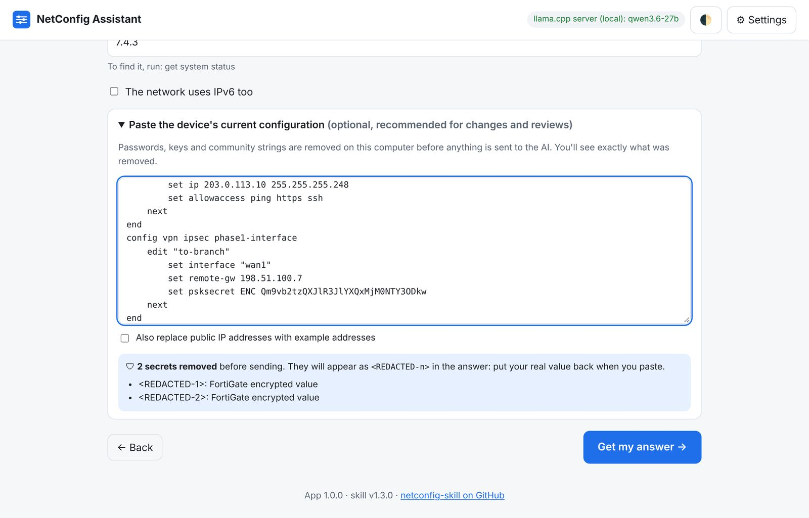
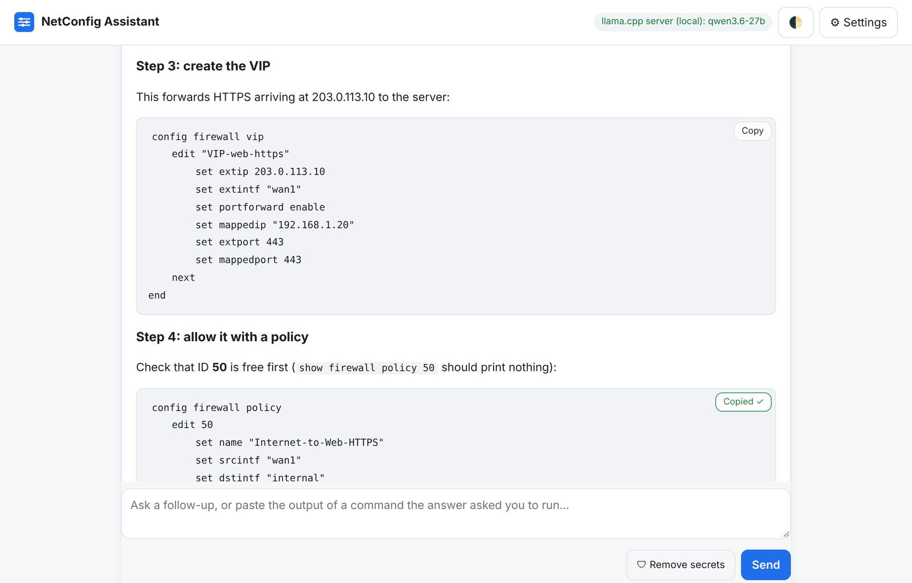
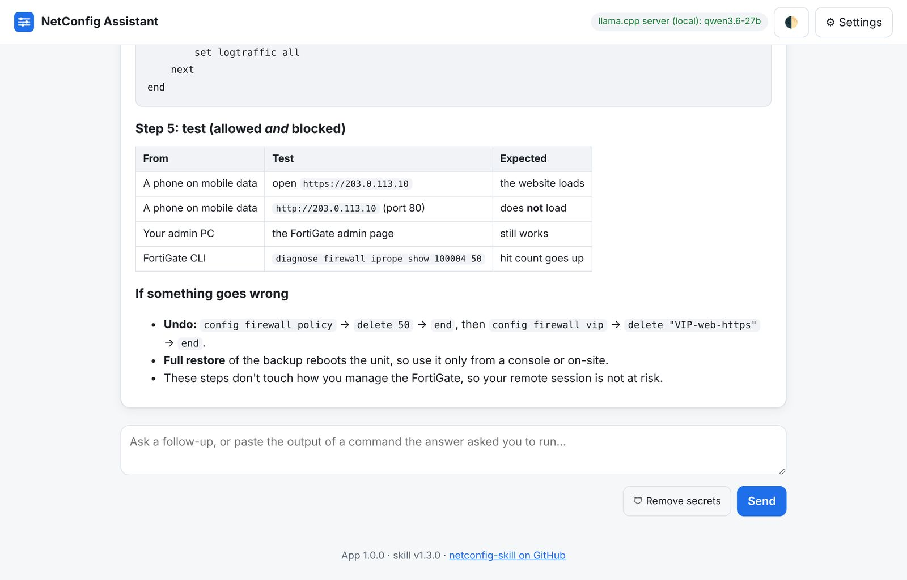
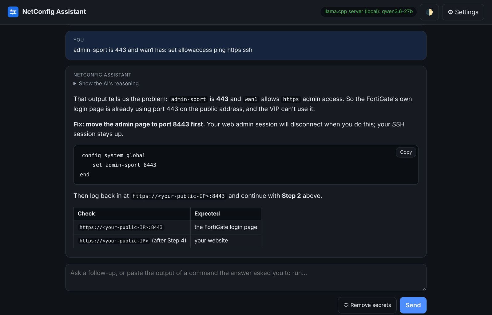

# NetConfig Assistant: user guide

NetConfig Assistant is a free app for people who need to configure a router, switch or firewall
but are **not** network experts. Pick your device, say what you want in your own words, and get
safe, step-by-step commands with a **Copy** button on each one.

It is built on the [network-config skill](../skills/network-config/SKILL.md), so every answer
follows the same safety rules a senior engineer would: check first, back up, keep a way back in,
test, and only then save.

**At a glance**

| | |
|---|---|
| **Devices** | Cisco (routers, switches, ASA, Nexus), FortiGate, Palo Alto, Juniper, MikroTik, Check Point, Huawei/H3C, Aruba/HPE, Arista, SonicWall, pfSense, VyOS, Sophos, UniFi, Linux firewalls, AWS/Azure/GCP firewalls |
| **Tasks** | set up something new, change a running device safely, fix a problem, review a config for security problems, move to another brand, ask a question |
| **AI** | a model on your own computer (llama.cpp, Ollama, LM Studio) or a cloud service (Claude, OpenAI, others) |
| **Privacy** | runs on your computer; passwords and keys are removed from pasted configs before anything is sent |
| **Safety** | advice only: the app never connects to your devices. You read and paste every command yourself |
| **Languages** | answers come back in the language you write in (English, Arabic, …) |
| **Needs** | Windows, macOS or Linux, and Python 3.9 or newer. Nothing else to install |

**Contents:**
[1. Install and start](#1-install-and-start) ·
[2. Connect an AI](#2-connect-an-ai-one-time) ·
[3. Ask for help](#3-ask-for-help) ·
[4. Read and use the answer](#4-read-and-use-the-answer) ·
[5. Follow-up questions](#5-follow-up-questions) ·
[Privacy](#privacy-what-leaves-your-computer) ·
[Troubleshooting](#troubleshooting) ·
[FAQ](#faq) ·
[For developers](#for-developers)

---

## 1. Install and start

### Get Python (once)
The app runs on Python, which is free.

- **Windows:** install it from [python.org/downloads](https://www.python.org/downloads/). On the
  first screen of the installer, **tick "Add python.exe to PATH"**. Or open *Terminal* and run
  `winget install Python.Python.3.12`.
- **macOS:** install it from [python.org/downloads](https://www.python.org/downloads/).
- **Linux:** usually already installed. If not: `sudo apt install python3` (Debian/Ubuntu).

### Download the app
- **Easiest:** download `NetConfig-Assistant.zip` from the
  [latest release](https://github.com/Lumax-Solutions/netconfig-skill/releases/latest) and unzip it.
- **Or** download the whole project ([ZIP](https://github.com/Lumax-Solutions/netconfig-skill/archive/refs/heads/main.zip)),
  unzip it and open the `app` folder.

### Start it
Double-click the start file:

| Computer | File to double-click |
|---|---|
| Windows | **Start NetConfig Assistant (Windows).bat** (or `app\start-windows.bat`) |
| macOS | **Start NetConfig Assistant (Mac).command** (or `app/start-mac.command`). The first time, right-click it → **Open** |
| Linux | `app/start-mac-linux.sh`, or run `python3 app/netconfig_app.py` |

A small black window opens and your web browser shows the app at `http://127.0.0.1:8765`.
**Keep the black window open while you use the app.** Close it when you're finished.

> Windows may show "Windows protected your PC" the first time. Click **More info → Run anyway**.
> The start file only runs `netconfig_app.py` with Python; you can open it in Notepad to check.

---

## 2. Connect an AI (one time)

The first time, the app asks which AI to use.

Click **Set up AI**. The app looks for AI programs already running on your computer and shows a
green button for each one it finds. Click it, then **Save**.

### Which AI should I use?

| Option | Good for | What you need |
|---|---|---|
| **AI on your computer** (llama.cpp, Ollama, LM Studio) | privacy, no cost per question | a good graphics card (GPU) and a model downloaded |
| **Claude** (Anthropic) | best answers without a powerful computer | an API key from [console.anthropic.com](https://console.anthropic.com/) |
| **OpenAI** | the same, with OpenAI models | an API key from [platform.openai.com](https://platform.openai.com/) |
| **Other** (DeepInfra, OpenRouter, vLLM, …) | other hosted or self-hosted models | the server address, and a key if it needs one |

**Running the AI on your computer:**
- **Ollama** (simplest): install from [ollama.com](https://ollama.com), then in a terminal run
  `ollama pull qwen3:32b` (or a smaller model if your computer has less memory).
- **LM Studio:** download a model, then go to *Developer* → **Start server**.
- **llama.cpp / llama-swap:** start `llama-server` as usual; the app looks for it on port 8080.

**Model size matters.** Configuring network devices needs a capable model. Models of about
**27–32 billion parameters** (for example Qwen 3.6 27B) give good answers on a single gaming GPU;
very small models (under 8B) often get commands wrong. Give the model at least **32k context**,
because the skill's instructions and the device's reference are sent with every question
(about 10–15 thousand tokens).

**Using a cloud AI:** choose it under *AI service*, paste your API key, press **↻ Load models**,
pick a model and **Save**. Use **Test connection** to check it.

The coloured label at the top right always shows which AI and model are in use. Green means
connected; red means the app can't reach it (click it to open Settings).

---

## 3. Ask for help

The app asks three short questions.

### Step 1: the device
Click the brand of your device. If you don't know it, click **Not sure** and paste the
configuration later: the app recognises most brands from it.

If two brands are involved (for example a VPN between a FortiGate and a Cisco router), tick
**It talks to a second device of another brand** and pick the second one too.

### Step 2: what you want to do

| Choose | When |
|---|---|
| **Set up something new** | a new device, a new feature, or a test lab |
| **Change a device that is running** | the device is in use and you must not break it |
| **Fix a problem** | something doesn't work; the answer tells you which read-only commands to run and how to read the result |
| **Check my config for problems** | a security review with a list of findings |
| **Move to another brand** | translate a configuration from one brand to another |
| **Just ask a question** | learn a concept or find the right command |

### Step 3: the details

1. **Describe what you need** in your own words, in any language. Not sure how to say it? Click
   one of the grey examples under the box.
2. **Is the device already working on a real network?** and **How will you connect to it?**
   These change how careful the answer is. If you are connected *remotely*, a wrong command could
   cut you off, so the answer sets up an automatic undo first.
3. **Software version.** Optional, but it helps a lot: commands change between versions. The app
   shows the command that displays it for your device (for a FortiGate: `get system status`).
4. **Paste the current configuration** (optional; recommended for changes, problems and reviews).
   Passwords and keys are removed **on your computer** before anything is sent. A blue box shows
   exactly what was removed:

Then click **Get my answer**.

---

## 4. Read and use the answer

The answer appears as it is written. It usually has these parts:

1. **Summary**: what will be done, in plain words. Technical terms are explained the first time.
2. **Assumptions and checks**: what the AI assumed (version, port names, addresses) and what could
   conflict. Read this table: if an assumption is wrong, say so in a follow-up before going on.
3. **Steps**: each step says what it does and where to type it. Every command block has a
   **Copy** button.
4. **Tests**: how to check it worked, including what should still be **blocked**.
5. **If something goes wrong**: how to undo it.

**Good habits:**
- Run the steps **in order**, one at a time, and look at the result of each before the next.
- If a step says *stop and tell me* when you see something, do that (use a follow-up).
- If you see `<REDACTED-1>` in a command, that's a password or key the app removed. Type your
  real value there before pressing Enter.
- Changing a remote device? Keep the automatic undo (rollback timer) the answer sets up, and only
  save when the tests pass.
- Reasoning models (like Qwen) "think" before answering. Click **Show the AI's reasoning** if you
  want to read it; otherwise ignore it.

**Save as file** (top right) downloads the whole conversation as a text (Markdown) file you can
keep, print or send to a colleague. **New request** starts again.

---

## 5. Follow-up questions

Type in the box at the bottom and click **Send** (or press Ctrl+Enter). Use it to:
- paste the **output of a command** the answer asked you to run (click **🛡 Remove secrets**
  first if the output might contain passwords),
- correct an assumption ("the internet port is `port1`, not `wan1`"),
- ask what a step means, or ask for the next step.

The 🌓 button at the top switches between light and dark mode.

---

## Privacy: what leaves your computer

| | With an AI on your computer | With a cloud AI |
|---|---|---|
| Your questions and pasted text | stay on your computer | sent to that AI company |
| Passwords, keys, SNMP communities in pasted configs | removed before sending | removed before sending |
| Public IP addresses | kept | kept, unless you tick *Also replace public IP addresses* |
| Settings and API key | saved on your computer | saved on your computer |

- The app only accepts connections from your own computer (`127.0.0.1`) and refuses requests from
  other websites. It doesn't collect statistics or send anything anywhere else.
- Secret removal covers the usual formats (Cisco, FortiGate, Juniper, Palo Alto, MikroTik, Huawei,
  private keys, API tokens) but can miss unusual ones. **Check the blue "removed" box, and the text,
  before sending a config to a cloud AI.**
- Settings are saved in `%APPDATA%\netconfig-app\settings.json` (Windows) or
  `~/.config/netconfig-app/settings.json` (macOS/Linux). An API key is stored there **unencrypted**.
  Don't save a cloud API key on a computer account other people use.

---

## Troubleshooting

| Problem | What to do |
|---|---|
| The black window says **Python 3 is needed** | Install Python (see [Get Python](#get-python-once)); on Windows tick *Add python.exe to PATH*. Then double-click the start file again |
| The browser doesn't open | Open `http://127.0.0.1:8765` yourself. If the app picked another port, the black window shows the address |
| **Can't reach the AI** | Start your AI program (llama-server, Ollama or LM Studio) and click **↻ Load models** in Settings. Check the server address |
| **No model selected** | Settings → **↻ Load models** → choose a model → **Save** |
| **The AI service refused the request (401/403)** | The API key is wrong or has no credit. Paste it again in Settings |
| The answer takes a long time to start | Normal for local models the first time (the model is loading). Big configs also take longer |
| The answer stops halfway | Raise *Max answer length* under Settings → Advanced, or ask "continue" |
| Answers are poor or commands look wrong | Use a bigger model, add the software version, and paste the config. Always check commands against the device's `?` help |
| Can't find the skill | Keep the `app` and `skills` folders together, as they are in the download |

---

## FAQ

**Can the app change my devices by itself?** No. It never connects to any device. You decide what
to paste.

**Is it free?** Yes (MIT licence). A local AI costs nothing per question; cloud AI services charge
for use.

**Does it work without internet?** Yes, with an AI on your computer.

**Can I trust the commands?** Treat them like advice from a careful colleague: usually right, not
always. The answer tells you how to test each change and how to undo it. Test on a lab or during a
quiet time when you can, and keep console access for important devices.

**Which AI gives the best answers?** The largest model you can use. Cloud models such as Claude
give the most reliable results; on your own computer, use the largest model your GPU can hold.

**Where do I report a wrong command?** Open an issue with the
[wrong-command form](https://github.com/Lumax-Solutions/netconfig-skill/issues/new/choose).
Please remove passwords and public addresses first.

---

## For developers

- Python standard library only (`http.server`, `urllib`). The UI is plain HTML, CSS and JavaScript
  with [marked](https://github.com/markedjs/marked) 12.0.2 (MIT) and
  [DOMPurify](https://github.com/cure53/DOMPurify) 3.1.6 (Apache-2.0 / MPL-2.0) included in
  `static/vendor/`. No build step.
- For each request the app sends the core `SKILL.md` and only the reference files that match the
  device and task (for example `fortigate.md` + `change-workflow.md`), so models without tool use
  still get the right material.
- API: `GET /api/status`, `GET /api/detect`, `POST /api/settings`, `POST /api/models`,
  `POST /api/sanitize`, `POST /api/chat` (Server-Sent Events: `meta`, `thinking`, `delta`, `done`,
  `error`).
- `python app/test_app.py`: offline tests (secret removal, prompt building, vendor guessing, a full
  streamed chat against a fake model). CI runs them on every push.
- `python app/sanitize.py < config.txt` (add `--ips`) runs secret removal on its own.
- `python scripts/build_app_zip.py`: builds `NetConfig-Assistant.zip` for a release.
- Options: `NETCONFIG_PORT` (default 8765, or the next free port), `NETCONFIG_SKILL_DIR` (use a
  skill installed elsewhere), `--no-browser`.
- The screenshots in `docs/` were taken with a stand-in model replaying a sample answer, so the
  pictures show the interface exactly; real answers vary by model.
