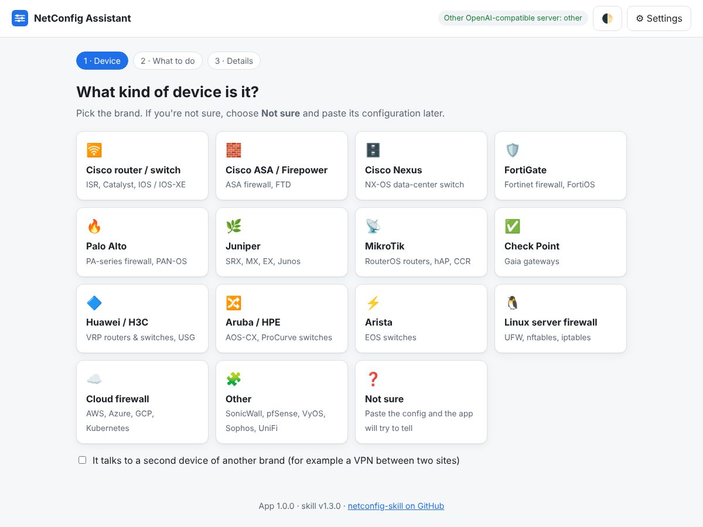
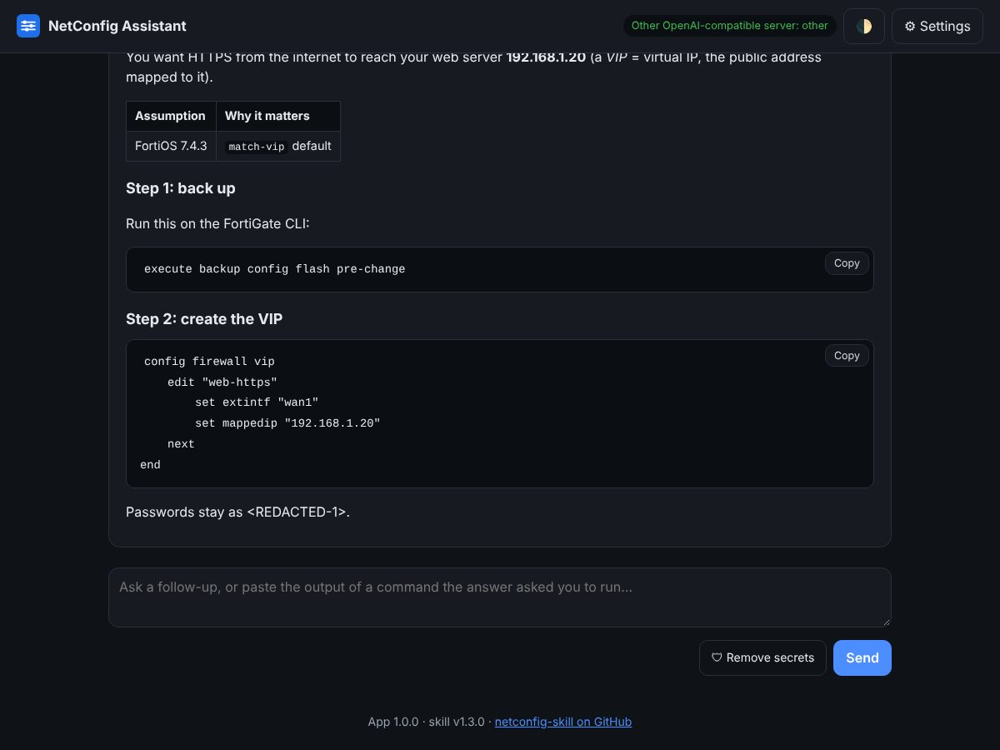

# NetConfig Assistant (desktop app)

A simple, guided app for people who are **not** network experts. Pick your device, say what you
want to do, and get safe step-by-step commands with a **Copy** button on each block. It uses the
[network-config skill](../skills/network-config/SKILL.md), so the answers follow the same safety
rules: back up first, keep a way back in, test before saving.

- **Advice only:** the app never connects to your routers, switches or firewalls. You paste every
  command yourself.
- **Private by default:** works with an AI model running on your own computer. Cloud AI (Claude,
  OpenAI) is optional.
- **Secrets removed before sending:** when you paste a configuration, passwords, keys and SNMP
  communities are replaced with `<REDACTED-n>` on your computer, and the app shows you what it
  removed. Public IP addresses can be swapped for example addresses too.
- No installation beyond Python. No accounts, no tracking. Works in English, Arabic and other
  languages (answers come back in the language you write in).

## Start it

You need **Python 3.9 or newer** ([python.org](https://www.python.org/downloads/); on Windows
tick *Add python.exe to PATH*, or run `winget install Python.Python.3.12`).

1. Download the repository ([ZIP](https://github.com/Lumax-Solutions/netconfig-skill/archive/refs/heads/main.zip))
   and unzip it.
2. Open the `app` folder and double-click:
   - **Windows:** `start-windows.bat`
   - **macOS:** `start-mac.command` (first time: right-click → Open)
   - **Linux:** `start-mac-linux.sh` (or run `python3 app/netconfig_app.py`)
3. Your browser opens at `http://127.0.0.1:8765`. Keep the small black window open while you use
   the app; close it to stop.

## Choose the AI (one time)

Click **Set up AI**. The app looks for AI servers already running on your computer and offers a
one-click button for each one it finds.

| Option | What you need | Address the app uses |
|---|---|---|
| llama.cpp `llama-server` / llama-swap | a running server | `http://127.0.0.1:8080/v1` |
| Ollama | Ollama open, a model pulled (`ollama pull qwen3`) | `http://127.0.0.1:11434/v1` |
| LM Studio | *Developer → Start server*, a model loaded | `http://127.0.0.1:1234/v1` |
| Claude (Anthropic API) | an API key | `https://api.anthropic.com/v1` |
| OpenAI API | an API key | `https://api.openai.com/v1` |
| Other OpenAI-compatible (vLLM, DeepInfra, OpenRouter, …) | its address, and a key if it needs one | your choice |

Press **↻ Load models**, choose a model, then **Save**.

**Which model?** Bigger is better for this job. On a local GPU, a 27B–32B model (for example
Qwen 3.6 27B) gives good answers; very small models (under 8B) often get commands wrong. Give the
model at least **32k context**: the skill and the device reference are sent with every request
(about 10–15k tokens).

Settings are saved in `%APPDATA%\netconfig-app\settings.json` (Windows) or
`~/.config/netconfig-app/settings.json` (macOS/Linux). An API key is stored there **unencrypted**,
readable by your user account only on macOS/Linux; don't use the app on a shared account with a
cloud key.

## How it works

1. **Device** – choose the brand (or *Not sure*; the app then guesses from the pasted config).
   Tick the second-device box for things like a VPN between two brands.
2. **What to do** – set up something new, change a live device, fix a problem, review a config,
   move to another brand, or just ask a question.
3. **Details** – describe it in your own words (or click an example), say whether the device is
   live and how you're connected, add the software version (the app shows the command that
   displays it) and optionally paste the configuration.

The app then sends the core skill plus only the reference files that match your device and task
(for example `fortigate.md` + `change-workflow.md`) to the model, so local models that can't read
files or use tools still get the right material. Answers stream in, with:
- a **Copy** button on every command block,
- the AI's reasoning hidden behind *Show the AI's reasoning* (for reasoning models such as Qwen),
- follow-up questions in the same conversation (paste command output there; the 🛡 button removes
  secrets from it first),
- **Save as file** to keep the whole conversation as Markdown.

## Safety notes

- The app only listens on `127.0.0.1` and refuses requests from other websites.
- Secret removal covers the common formats (Cisco, FortiGate, Junos, Palo Alto, MikroTik, Huawei,
  PEM keys, API tokens) but can miss unusual ones. Look at the "secrets removed" list and the text
  before sending to a **cloud** AI.
- AI answers can be wrong. The skill makes the model plan a way back (rollback timers, console
  access, saving only after testing): follow those steps on any live device.

## For developers

- Standard-library Python only (`http.server`, `urllib`); the UI is plain HTML/CSS/JS with
  [marked](https://github.com/markedjs/marked) 12.0.2 (MIT) and
  [DOMPurify](https://github.com/cure53/DOMPurify) 3.1.6 (Apache-2.0/MPL-2.0) vendored in
  `static/vendor/`. No build step.
- `python app/test_app.py` runs offline tests (secret removal, prompt building, a full streamed
  chat against a fake model); CI runs them on every push.
- `python app/sanitize.py < config.txt` (add `--ips`) runs secret removal on its own.
- Environment variables: `NETCONFIG_PORT` (default 8765, or the next free port),
  `NETCONFIG_SKILL_DIR` (use a skill installed elsewhere); `--no-browser` to not open a browser.
